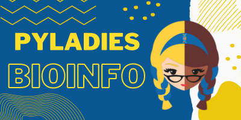

  

# Proposta de Dinâmica de Projeto

O ato de escrever programas de computador é uma arte e uma ciência. Precisamos aprender a modelar os problemas do mundo real e transpô-los para uma linguagem de programação. Para tal, precisamos definir os objetos, seus atributos, relacionamentos e funcionalidades no nosso sistema. Dessa forma, programar é ir além de saber os elementos bases da linguagem, é integrar conceito, modelar propriedades, definir requisitos e o escopo aplicado. Além disso, é essencial que utilizemos as técnicas certas. Espera-se ao final um produto que cumpra seu objetivo com o mínimo de erros. Aprendemos o básico, agora vamos iniciar a nossa trajetória com as ferramentas certas para resolvermos um problema por meio da programação.

## Objetivos desta proposta
- Com este projeto pretendemos estimular as participantes a aplicarem conceitos básicos de bioinformática aliado a boas práticas de programação.

## Desafios
- Implementar um programa que resolva um `problema` comum na bioinformática
- Melhorar o código seguindo os princípios SOLID e Padrões de Projeto
- Testar as funcionalidades do programa seguindo a metodologia de desenvolvimento orientado a testes.
- Automatizar a execução do programa
- Documentar a implementação
- Disponibilizar implementação em um repositório do github

## Problemas

| Nivel | Proposta |
|---|---|
|Básico| Criar um pacote que lide com criação e manipulação de sequências de DNA, RNA e Proteínas.|
|Intermediário| Criar um pacote que permita a manipulação de arquivos e sequências de DNA, RNA e proteínas.|
|Avançado| Criar um pacote que permita a integração de APIs de bancos de dados de sequências de DNA, RNA e Proteínas.|

##  Recomendações

- Leia o material de apoio para que possas entender o problema proposto assim como os desafios atrelados à implementação do projeto.
- Instale o interpretador da linguagem Python no seu computador.
- Modele o  seu problema e suas  soluções,   defina  claramente o escopo do seu projeto.
- Utilize somente pacotes nativos da linguagem Python, mas você pode utilizar gerenciadores como Mamba e formatadores de código como Ruff.
- Utilize uma Interface de Desenvolvimento para gerenciar o seu projeto.
- Documente a sua implementação.
- Disponibilize o seu projeto no github.

## Dinâmica de trabalho em dupla

- Escolha uma parceira para ajudá-la na execução do seu projeto seja como mentora ou como colaboradora.
- Leia as instruções a seguir: [Recomendações para o Sucesso da Dinâmica em Dupla](docs/work.md).

## Roteiro de desenvolvimento
- Abertura: Encontro de abertura
- Semana   I: Implementação  base das soluções propostas
- Checkpoint I: Encontro para discussão sobre a Semana I
- Semana  II: Revisão de  boas  práticas e padrões de projeto
- Checkpoint II: Encontro para discussão sobre a Semana II
- Semana III: Implementação de  testes e automatização
- Checkpoint III: Encontro para discussão sobre a Semana III
- Semana  IV: Revisão e documentação
- Encerramento: Encontro para discussão sobre a Semana IV

## Requisitos

- [Python](https://www.python.org/) 
- [Mamba](https://mamba.readthedocs.io/en/latest/) (opcional)
- [Ruff](https://docs.astral.sh/ruff/) (opcional)
- [Visual Studio Code](https://code.visualstudio.com/) (opcional)
- [Github Projects](https://docs.github.com/pt/issues/planning-and-tracking-with-projects) (opcional)

## Material de apoio
- [Como instalar Python e  VS Code](https://www.youtube.com/watch?v=R9dLGLVqK9Q&t=784s)
- [Modelando um  problema  e programando em python](https://www.youtube.com/watch?v=gjQY6-uL05w)
- [Sequências biológicas](docs/bioinfo.md)
- [Estruturando seu projeto](docs/tree.md)
- [Desenvolvimento de software e boas práticas de programação](docs/software.md)
- [O que são pacotes](docs/pkg.md)
- [Como documentar seu código](docs/docstring.md)
- [Princípios SOLID](docs/solid.md)
- [Padrões de Projeto](docs/patterns.md)
- [Desenvovimento Orientado a testes](docs/tdd.md)

## Oferecimento

Este repositório destina-se a atividade de execução de projetos práticos em Bioinformática do Curso de Nivelamento em Python das Pyladies Bioinfo disponível em https://github.com/biopyladies/PyClass.

